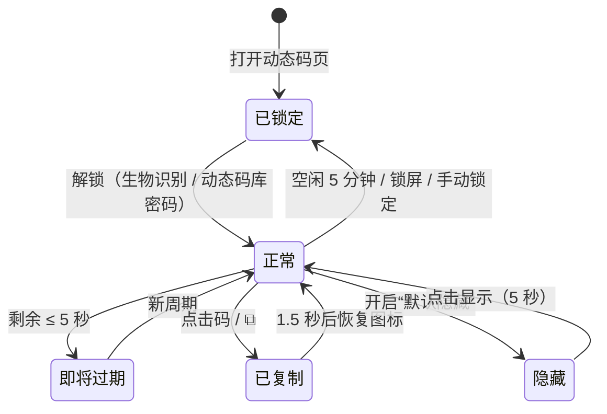
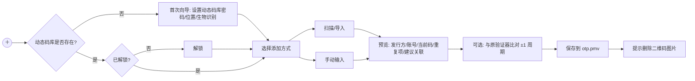

# 08 动态码（2FA / TOTP）管理设计

> 目标：让 PasswordManager 同时充当“身份验证器”——保存两步验证（2FA）密钥，实时生成动态码，并在 Windows 应用、浏览器、Android 中**直接填充**动态码。
> 主要标准：TOTP（RFC 6238）；兼容 HOTP（RFC 4226，次要）与 Steam Guard（特殊编码）。
> 相关文档：需求 01 §3.7、威胁模型 03 §5.2（T21–T30）、Windows 04 §14、Android 05 §8、浏览器 05b §13、同步 06 §5。
> **存储决策**：动态码密钥默认保存在**独立的动态码库 `otp.pmv`（独立密码）**中，见 §1。界面参考常见身份验证器 App 的卡片式设计，见 §11。

## 1. 存储与数据模型

### 1.1 默认：独立动态码库 `otp.pmv`
> **决策**：动态码密钥**默认保存在独立的动态码库 `otp.pmv` 中，使用独立的“动态码库密码”**，不与密码保险库 `vault.pmv` 混存。这样即使密码保险库（主密码 + 文件）泄露，第二因素仍然安全，2FA 不会退化为单因素（03 T21）。

| 项 | 密码保险库 `vault.pmv` | 动态码库 `otp.pmv`（默认） |
|---|---|---|
| 文件格式 | 03 §2 | 同一格式（魔数 `PMV1`、Argon2id、AES-256-GCM），负载 `"kind": "otp"` |
| 解锁密码 | 主密码 | **独立的动态码库密码**（必须与主密码不同） |
| Vault Key / salt | 独立 | 独立（随机生成，互不派生） |
| 快速解锁 | Windows Hello / Android 生物识别包装主库 Key | **单独的** Windows Hello 凭据 / 单独的 Android Keystore 密钥（`setUserAuthenticationRequired(true)`，生物识别变更即失效）包装 OTP 库 Key |
| 自动锁定 | 默认空闲 10 分钟 | 独立计时，默认空闲 **5 分钟**；锁屏/休眠立即锁定 |
| 同步位置 | 用户选择 | **独立选择**，建议与 `vault.pmv` 不同的位置，或只保存在手机上不同步（06） |
| 可在对方锁定时使用 | — | 可以：动态码项自带匹配规则，填充动态码不需要解锁密码保险库 |

- **首次使用向导**：在“动态码”页首次点击 ＋ 时创建 `otp.pmv`：设置动态码库密码（强度计）、选择保存/同步位置、可选启用生物识别快速解锁。
- **防止与主密码相同**：设置或修改动态码库密码时，用候选密码尝试解包本机 `vault.pmv` 的 Vault Key（离线计算一次 Argon2id）；若能解开则拒绝并提示“动态码库密码不能与主密码相同”。反之修改主密码时也对 `otp.pmv` 做同样检查。
- **不提供**“解锁密码库时自动解锁动态码库”的联动选项（会重新耦合两者）；两库可各自用生物识别快速解锁以保持便利。
- **高级（不推荐）：同库存储**。仅在“设置 → 高级 → 动态码存储位置”中提供，开启时需输入主密码并确认风险提示：“动态码将与密码保存在同一保险库，保险库泄露时两步验证失效”。开启后动态码项保存在 `vault.pmv` 负载的 `otpItems` 数组中（结构与 §1.2 相同），可随时迁回独立库。

### 1.2 动态码项（`otp.pmv` 负载）
```json
{
  "schema": 1, "kind": "otp", "vaultId": "…", "revision": 42, "keyEpoch": 1,
  "items": [{
    "id": "uuid",
    "totp": {
      "type": "totp",                 // totp（默认）| hotp | steam
      "secret": "JBSWY3DPEHPK3PXP",   // 即需求中的 totpSecret：Base32（RFC 4648，大写、无填充、无空格）
      "algorithm": "SHA1",            // SHA1（默认）| SHA256 | SHA512
      "digits": 6,                    // 6（默认）| 8；steam 固定 5 位字符
      "period": 30,                   // 秒，默认 30；允许 15–300
      "counter": null,                // 仅 hotp：下一个要使用的计数器值
      "issuer": "GitHub",             // 发行方标签
      "account": "82488059"           // 账号标签
    },
    "display": { "icon": "builtin:github", "pinned": true, "order": 1, "note": "" },
    "match": {                         // 自带匹配规则，用于浏览器/Windows/Android 填充动态码
      "uris": [{ "uri": "https://github.com", "match": "domain" }],
      "windowsApps": [], "androidApps": []
    },
    "linkedEntryId": "密码保险库中对应条目的 id，或 null",
    "totpHistory": [{ "secret": "…", "retiredAt": "…" }],
    "fieldTimes": { "totp": "…", "display": "…", "match": "…" },
    "created": "…", "updated": "…", "updatedBy": "win-7a1c",
    "deleted": false, "deletedAt": null
  }],
  "settings": { "hideCodes": false, "clipboardClearSec": 30, "boundaryWaitSec": 3, "settingsUpdated": "…" }
}
```
- **关联而不合并**：密码保险库条目中**不保存**任何动态码信息；关联关系只记录在动态码项的 `linkedEntryId`（从而密码保险库泄露也不会暴露“哪些账号开启了 2FA”）。关联时把条目的 URI/应用规则**复制**到 `match`，此后各自维护；条目详情页在两库都解锁时显示“已关联动态码”。
- 校验：Base32 解码后至少 10 字节（80 位）才允许保存；< 16 字节（128 位，RFC 4226 建议下限）时提示“密钥较短”，但不阻止（部分服务确实使用 80 位）。
- 规范化：手工输入时去除空格、连字符，转大写，去除 `=` 填充。
- `totp` 对象在同步合并中视为**一个不可分割的整体**（密钥与算法/位数/周期必须同时生效，见 06 §5）。

## 2. 生成算法
### 2.1 TOTP（RFC 6238）
```
T   = floor((unixTime + clockOffset - T0) / period)，T0 = 0
msg = T 的 8 字节大端整数
h   = HMAC-<algorithm>(K = Base32Decode(secret), msg)
o   = h[len(h)-1] & 0x0F
bin = ((h[o] & 0x7F) << 24) | (h[o+1] << 16) | (h[o+2] << 8) | h[o+3]
code = (bin mod 10^digits)，左侧补 0 至 digits 位
```
### 2.2 HOTP（RFC 4226，次要）
同上，但 `msg = counter`。每次生成（用户点“下一个”或填充）后 `counter += 1` 并立即保存保险库；不预生成。
### 2.3 Steam Guard
- 算法：SHA1、30 秒周期，截断方式与 TOTP 相同，但输出为 **5 个字符**：对 `bin` 重复 5 次 `bin % 26` 取字母表 `23456789BCDFGHJKMNPQRTVWXY` 中的字符、`bin /= 26`。
- 密钥来源：Steam 手机令牌的 `shared_secret`（Base64），导入时转换为 Base32 保存；也接受 `otpauth://totp/Steam:<账号>?secret=…&issuer=Steam` 及带 `encoder=steam` 参数的 URI（若 issuer 为 Steam 则询问是否按 Steam 编码）。
- 说明：只生成登录码，**不支持** Steam 交易/市场确认（需要 `identity_secret` 与 Steam 私有 API，超出范围）。将令牌转移到本应用需要用户自行从原令牌取得密钥，界面上给出风险提示。

### 2.4 实现约束
- 只在 Rust `pm-core` 中实现一次：`hmac` + `sha1`/`sha2`（RustCrypto）；不得自行实现 HMAC。C++/QML（经 cxx）与 Kotlin（经 UniFFI）只取“当前码 + 剩余秒数”，从不接触密钥。
- 秘密解码后的字节数组在计算后立即清零；只缓存“当前周期的动态码”，周期结束即丢弃。
- 动态码**只在受信端**（桌面应用 / Android 应用）计算；浏览器扩展只接收结果（码 + 剩余秒数），**从不接收密钥**。

## 3. 导入
| 方式 | Windows | Android | 说明 |
|---|---|---|---|
| `otpauth://` URI 粘贴 | ✓ | ✓ | 解析见 §3.1 |
| `otpauth-migration://`（Google 身份验证器“转移账号”导出） | ✓（扫码/粘贴） | ✓ | 批量导入，见 §3.2 |
| 扫描二维码：图片文件 / 剪贴板图片 | ✓ | ✓（从相册选取） | 由 pm-core 中的 `rxing`（Rust 版 ZXing）本地解码，**不联网** |
| 扫描二维码：屏幕区域截取 | ✓（框选屏幕区域，类似截图工具） | — | 网页上显示的 2FA 设置二维码可直接框选导入 |
| 扫描二维码：摄像头 | ✓（Qt Multimedia 取帧，若有摄像头） | ✓（Qt Multimedia 取帧；不依赖 Google Play 服务） | 需相机权限，用完即释放 |
| 手工输入 Base32 | ✓ | ✓ | 高级选项中设置算法/位数/周期 |
| Steam `shared_secret` / maFile | ✓ | ✓ | 见 §2.3 |
| 其他验证器导出（Aegis、2FAS、andOTP 的明文 JSON；Bitwarden/KeePassXC 的 TOTP 字段） | 后续版本 | 后续版本 | 列入路线图 |

### 3.1 `otpauth://` 解析
```
otpauth://totp/GitHub:alice%40example.com?secret=JBSWY3DPEHPK3PXP&issuer=GitHub&algorithm=SHA1&digits=6&period=30
otpauth://hotp/Example:bob?secret=…&counter=0
```
- label 为 URL 编码的 `issuer:account`（冒号可为 `%3A`）；若 query 中也有 `issuer`，以 query 为准，不一致时提示。
- 缺省值：algorithm=SHA1、digits=6、period=30；`hotp` 必须有 `counter`。
- 严格解析：URI 长度 ≤ 4096；`secret` 必须是合法 Base32；`digits` ∈ {6,7,8}（7 位仅兼容显示）；`period` 15–300；未知参数忽略并记录（不记录 secret）。
- 去重：若 `otp.pmv` 中已有同 `issuer` + `account` 的动态码项且密钥不同 → 提示“将替换现有动态码密钥（旧密钥保留在历史中 30 天）”或“另存为新项”。
- 关联建议：若密码保险库也已解锁，按 `issuer` 与条目标题/URI 的可注册域、`account` 与用户名匹配，建议“关联到密码条目「GitHub（alice）」”（复制其匹配规则，见 §1.2）；密码保险库锁定时跳过，之后可在动态码项菜单中“关联密码条目”。未关联时按 `issuer` 内置映射生成默认 URI（如 GitHub → `https://github.com`），用户可编辑。

### 3.2 `otpauth-migration://`（Google 身份验证器导出）
- 格式：`otpauth-migration://offline?data=<URL 编码的 Base64>`，`data` 为 Protocol Buffers `MigrationPayload`：
  ```
  message MigrationPayload {
    repeated OtpParameters otp_parameters = 1;
    int32 version = 2; int32 batch_size = 3; int32 batch_index = 4; int32 batch_id = 5;
  }
  message OtpParameters {
    bytes secret = 1;        // 原始字节 → 本应用转 Base32
    string name = 2;         // 账号
    string issuer = 3;
    Algorithm algorithm = 4; // 0 未指定(按 SHA1) 1 SHA1 2 SHA256 3 SHA512 4 MD5(不支持，跳过并提示)
    DigitCount digits = 5;   // 0 未指定(按 6) 1 六位 2 八位
    OtpType type = 6;        // 0 未指定(按 TOTP) 1 HOTP 2 TOTP
    int64 counter = 7;
  }
  ```
- 周期固定 30 秒（该格式不携带 period）。
- **多张二维码批次**：根据 `batch_size / batch_index / batch_id` 显示“已扫描 2/3”，全部扫完后一次性预览；允许部分导入。
- 预览列表：发行方、账号、类型、当前动态码（供用户与原验证器比对）、勾选导入、重复项与建议关联的密码条目。
- 使用最小的手写 protobuf 解码器（仅支持上述字段的 varint/length-delimited），对长度做上限检查，不引入完整 protobuf 运行时。

### 3.3 导入后校验与收尾
- “与原验证器比对”：显示当前码与下一码；或让用户输入原验证器上的当前码，以 **±1 周期窗口**验证密钥是否正确（§6）。
- 提示用户**删除含二维码的截图/图片**（本应用不保存二维码图像；屏幕截取与摄像头帧只在内存中处理）。
- 服务端首次开启 2FA 时（网站要求“输入验证器上的 6 位码以确认”），可在导入后直接点“填充/复制当前码”完成绑定。

## 4. 显示
- 详细的界面规格（卡片、倒计时、悬浮按钮、搜索、置顶等）见 §11。要点：大号数字（3+3 分组，如 `796 376`），环形倒计时与“N秒”，剩余 ≤ 5 秒时变色并预显示**下一个码**；可选“默认隐藏动态码，点击显示”。
- HOTP 显示“生成下一个”按钮而非倒计时；Steam 显示 5 位字符。
- 时钟状态提示（§6）：若检测到系统时间未同步，顶部显示黄色警告。
- **防截屏**：
  - Windows：动态码相关窗口调用 `SetWindowDisplayAffinity(hwnd, WDA_EXCLUDEFROMCAPTURE)`（Windows 10 2004+；更早版本退化为 `WDA_MONITOR`）——截图/录屏/共享屏幕中显示为黑块。设置项可关闭（远程协助时需要）。
  - Android：显示动态码的 Activity 设置 `WindowManager.LayoutParams.FLAG_SECURE`（禁止截屏、录屏、最近任务缩略图）。
  - 浏览器扩展弹出窗口：浏览器不提供防截屏能力，弹窗中动态码默认隐藏，点按显示，5 秒后再次隐藏。

## 5. 复制与填充
| 渠道 | 方式 |
|---|---|
| 复制 | 写剪贴板时排除剪贴板历史/云剪贴板（同密码）；**在当前码过期时或 30 秒后（取较早者）自动清除**；剩余 < 3 秒时复制，自动改为复制下一个码并提示 |
| Windows Auto-Type | 序列占位符 `{TOTP}`；为“二次验证窗口”单独配置规则与序列，如 `{TOTP}{ENTER}`；热键 Ctrl+Alt+T 对当前窗口匹配的动态码项只输入动态码（04 §14） |
| 浏览器 | 识别 OTP 输入框并填充（05b §13）；可选“填充密码后自动复制动态码” |
| Android | 自动填充识别 OTP 字段并提供动态码数据集（05 §8） |

**边界等待**：填充/输入动态码时若当前周期剩余 < 3 秒（可配置 0–10），则等待到下一周期再使用新码，避免提交时已过期。

## 6. 时钟偏差处理
- 生成依赖本机时间。动态码由服务端按其时间验证，通常服务端允许 ±1 个周期的偏差；本应用侧措施：
  1. **边界等待**（§5）降低“刚好跨周期”的失败。
  2. **时间同步检测**：Windows 读取 W32Time 服务状态与“自动设置时间”设置；Android 读取 `Settings.Global.AUTO_TIME`。未开启自动同步时显示警告并给出系统设置入口。本应用默认不联网，不自行做 NTP。
  3. **手动校准（可选）**：用户输入任一服务/原验证器当前显示的码，本应用在 ±10 个周期内搜索匹配，计算 `clockOffset`（秒级，按设备本地保存，不同步），仅在偏差 > 1 个周期时建议应用。
  4. **导入验证**：输入原验证器上的码时，在 **±1 周期窗口**（T−1、T、T+1）内匹配即视为密钥正确；在 ±1 之外但 ±10 之内匹配，则提示“密钥正确但设备时间可能偏差约 N 秒”。
- HOTP 同步：服务端计数器领先时，提供“重新同步”：用户输入连续两个服务端接受的码（或原验证器的码），在 `counter … counter+50` 内搜索并更新计数器。

## 7. 安全要求
| 要求 | 说明 |
|---|---|
| 加密与隔离 | `totp.secret` 保存在**独立的 `otp.pmv`**（独立密码、独立 Vault Key、独立 Argon2id salt），加密强度与密码保险库相同（AES-256-GCM）；内存中以可清零缓冲持有；动态码库锁定时清除；动态码库密码不得与主密码相同（§1.1） |
| 日志 | 任何日志、审计记录、崩溃信息中**不得出现** secret、otpauth URI、动态码；审计只记录“条目 X 生成/填充了动态码” |
| 剪贴板 | 同 §5：排除历史、短时自动清除；设置项可禁用动态码复制，只允许直接填充 |
| 防截屏 | §4 |
| 扩展边界 | 扩展只拿到码 + 剩余秒数；`totp.get` 需 Origin 复核（与 `credentials.get` 相同，05b §7）；动态码库锁定时返回 `OTP_LOCKED`，解锁只能在桌面应用窗口中进行 |
| 导出/备份 | 动态码库单独导出/备份（不随密码保险库导出）；加密导出（`otp.pmv` 副本）自然包含密钥；明文导出（CSV / otpauth 列表 / 二维码打印页 / `otpauth-migration` 二维码）须重新输入动态码库密码、显示风险确认，且**默认不勾选“包含动态码密钥”**；明文导出文件建议保存到加密介质 |
| 二维码图像 | 不保存；内存中解码后立即释放 |
| 历史 | 替换动态码密钥时旧密钥进入 `totpHistory`（保留 30 天，可手动清除），用于误操作恢复 |
| 删除 | 删除条目或移除动态码时同时清除 `totpHistory`；墓碑中不保留 |

## 8. 同步
- 动态码密钥随 **`otp.pmv`** 独立同步，机制与 06 完全相同（本地 base 副本、三方合并、墓碑、冲突副本识别），但同步位置单独配置；推荐与 `vault.pmv` 不同的网盘/目录，或“仅本机（手机）不同步”。
- 两库互不依赖：任何一方同步失败不影响另一方；`linkedEntryId` 指向的条目被删除时，动态码项保留并显示“关联的密码条目已删除”。
- 合并：`totp` 对象整体作为一个字段参与三方合并（06 §5）：只一方修改 → 取该方；双方修改为不同值 → 取 `fieldTimes.totp` 较新者，另一方进入 `totpHistory` 并进冲突中心。
- HOTP 的 `counter`：合并时取**两者最大值**（计数器只增不减，取较大者不会导致重复使用旧码）。
- `clockOffset` 属设备本地设置，不同步。

## 9. 测试向量（`testvectors/totp.json`，由 pm-core `cargo test` 校验）
来自 RFC 6238 附录 B（8 位，周期 30）与 RFC 4226 附录 D：
| 种子（ASCII） | 算法 | 时间 / 计数器 | 期望 |
|---|---|---|---|
| `12345678901234567890` | SHA1 | t=59 | `94287082` |
| `12345678901234567890` | SHA1 | t=1111111109 | `07081804` |
| `12345678901234567890123456789012` | SHA256 | t=59 | `46119246` |
| `1234567890123456789012345678901234567890123456789012345678901234` | SHA512 | t=59 | `90693936` |
| `12345678901234567890` | HOTP-SHA1，6 位 | counter=0 / 1 | `755224` / `287082` |
另含：Base32 规范化用例、otpauth URI 正反例（缺 secret、非法 Base32、超长 URI）、自生成的 `otpauth-migration` 样本（单批/多批、MD5 跳过）、Steam 编码样本（由两个独立实现交叉验证后写入）。

## 10. UI 文案示例
- “已添加 GitHub（alice@example.com）的动态码。请删除包含二维码的截图。”
- “系统时间未自动同步，动态码可能无效。[打开时间设置]”
- “此网站与 github.com 相似，已阻止填充动态码。”
- “导出将包含 12 个动态码密钥的明文，任何获得该文件的人都能生成你的验证码。”
- “动态码库已锁定。[解锁动态码库]”
- “动态码库密码不能与主密码相同。”

## 11. 界面设计（参考常见身份验证器 App 的卡片式布局）

> 用户提供的参考截图：深色背景、绿色强调色；顶部为“盾牌+对勾”图标与标题、右上角菜单按钮；动态码以卡片列表呈现（发行方图标 + “GitHub: 82488059”、⋮ 菜单、大号 6 位码中间空格、复制按钮、快捷操作按钮、“3秒”与圆形进度）；空白区域；右下角绿色圆形 ＋ 悬浮按钮。
> 本设计在三端复用这一信息结构；Windows 与 Android 为同一套 QML 组件（§11.11），浏览器弹窗为扩展内的精简 HTML 版本。**视觉上与常见身份验证器相似，但不复制任何商标**（详见 §11.10）。

### 11.1 视觉规范（深色主题为参考，浅色主题跟随系统）
| Token | 深色 | 浅色 | 用途 |
|---|---|---|---|
| `bg/page` | `#050814` | `#F5F7FA` | 页面背景 |
| `bg/card` | `#1A2232` | `#FFFFFF` | 卡片背景，圆角 8px，1px 描边 `#273246` / `#E3E8EF` |
| `accent` | `#10B981`（翠绿） | `#059669` | 标题、图标、FAB、焦点环、进度环 |
| `text/primary` | `#E6EAF0` | `#111827` | 动态码、发行方 |
| `text/secondary` | `#9AA4B2` | `#6B7280` | 账号、秒数、图标按钮 |
| `warn` | `#F59E0B` | `#D97706` | 剩余 ≤ 5 秒、时间未同步 |
| `danger` | `#EF4444` | `#DC2626` | 删除、剩余 ≤ 2 秒 |
- 字体：系统 UI 字体（Windows：Microsoft YaHei UI / Segoe UI；Android：系统默认）；动态码使用**等宽数字**（QML `font.features: { "tnum": 1 }`，Qt 6.6+；浏览器弹窗 CSS `font-variant-numeric: tabular-nums`），28px（桌面）/ 28sp（Android），避免数字跳动。
- 分组：6 位 `796 376`（3+3）；8 位 `1234 5678`（4+4）；Steam 5 位不分组。复制时不含空格。
- 对比度 ≥ 4.5:1（WCAG AA）；所有图标按钮触控区域 ≥ 40×40px / 48dp。

### 11.2 页面线框（Android 竖屏 / Windows 窄窗口）
```
┌──────────────────────────────────────┐
│ [盾✓] 动态码                 [🔍] [≡] │  ← 顶栏：自有盾牌图标 + 标题；搜索；菜单
├──────────────────────────────────────┤
│ ⚠ 系统时间未自动同步，动态码可能无效 [设置]│  ← 仅在异常时显示的提示条
│ 已置顶 ───────────────────────────────│
│ ┌──────────────────────────────────┐ │
│ │ (GH) GitHub: 82488059          ⋮ │ │  ← 图标 + 发行方(粗体): 账号；溢出菜单
│ │ 796 376   [⧉] [✦]       3秒  (◔) │ │  ← 大号码、复制、快捷操作；秒数 + 圆形进度
│ │            下一个 104 552          │ │  ← 仅剩余 ≤5 秒时出现
│ └──────────────────────────────────┘ │
│ 全部 ─────────────────────────────────│
│ ┌──────────────────────────────────┐ │
│ │ (支) 支付宝: 138****5678       ⋮ │ │
│ │ 205 918   [⧉] [✦]      21秒  (◕) │ │
│ └──────────────────────────────────┘ │
│ ┌──────────────────────────────────┐ │
│ │ (S)  Steam: zhangtuo           ⋮ │ │
│ │ 7KQ2D     [⧉]          21秒  (◕) │ │
│ └──────────────────────────────────┘ │
│                                      │
│                                (＋)  │  ← 绿色圆形悬浮按钮（FAB）
└──────────────────────────────────────┘
```

### 11.3 卡片规格
| 元素 | 规格与交互 |
|---|---|
| 发行方图标 | 24px；优先内置图标集（见 §11.10），否则用发行方首字母/首个汉字的圆形头像（颜色由 issuer 哈希决定）；用户可在编辑中更换或关闭图标 |
| 标签 | `**发行方**: 账号`，单行省略；账号过长时中间省略（`zhang…@qq.com`）；无 issuer 时只显示账号 |
| ⋮ 溢出菜单 | 编辑（名称/账号/图标/匹配网站与应用）｜置顶 / 取消置顶｜关联密码条目…｜复制下一个码｜查看密钥 / 导出二维码（需重新验证动态码库密码，见 §7）｜时间校准…｜删除（二次确认，可在“最近删除”中 30 天内恢复） |
| 动态码 | **点击动态码即复制**（与点击 ⧉ 等效），Toast/气泡“已复制，30 秒后清除”；剩余 < 3 秒时复制下一个码并提示“已复制下一个码”；开启“默认隐藏”时显示 `●●● ●●●`，点击先显示 5 秒，再次点击复制 |
| ⧉ 复制按钮 | 同上；键盘 Enter / Ctrl+C |
| ✦ 快捷操作（可选，设置中可隐藏） | **Windows**：“输入到上一个窗口”——把码自动输入到打开本应用前的前台窗口（Auto-Type，带焦点校验，04 §5.4）；**浏览器弹窗**：“填充到当前网页”；**Android**：“复制并返回上一个应用” |
| 倒计时 | 文字“N秒” + 16px 圆形进度（扇形随时间减少，与截图一致）；每秒在系统时钟整秒边界刷新；剩余 ≤ 5 秒变 `warn` 色并显示“下一个”码，≤ 2 秒变 `danger` 色；周期结束时码值淡入切换（系统“减少动画”开启时直接切换） |
| HOTP 卡片 | 倒计时位置改为 [↻ 生成下一个] 按钮；码值显示直到下次生成 |
| 长按 / 右键 | 进入多选（批量置顶、删除、导出）；拖动手柄排序（排序方式为“手动”时） |

### 11.4 卡片状态（mermaid）

已锁定状态下列表只显示一张锁卡片：“动态码库已锁定 [解锁]”，**不显示任何发行方/账号**（防止窥视得知开启了哪些 2FA）。

### 11.5 悬浮按钮（FAB）与添加流程
- 位置：右下角，56dp / 48px 圆形，`accent` 底色 + 白色/深色“＋”；滚动列表时保持可见（Android 下滑时可缩小）。
- 点击展开速拨菜单（Windows 为弹出菜单）：
```
                    ┌ 扫描二维码（相机）        ─ Android；Windows 有摄像头时
                    ├ 从屏幕扫描二维码          ─ 仅 Windows（框选屏幕区域）
           (＋) ──► ├ 从图片导入                ─ 文件 / 相册 / 剪贴板图片
                    ├ 粘贴 otpauth:// 链接
                    ├ 手动输入密钥
                    └ 从 Google 身份验证器导入  ─ otpauth-migration，多批次
```

- **手动输入**表单：
```
┌ 手动添加动态码 ─────────────────────────┐
│ 发行方  [ GitHub            ]           │
│ 账号    [ 82488059          ]           │
│ 密钥    [ JBSW Y3DP EHPK 3PXP ] 👁       │  ← 自动去空格、大写、Base32 实时校验
│ ▸ 高级：类型[TOTP▼] 算法[SHA1▼] 位数[6▼] 周期[30]秒 │
│ 匹配网站 [ https://github.com ]（可选）   │
│ 预览：796 376  (◔ 3秒)                  │  ← 输入合法后立即显示，便于与网站核对
│              [取消]   [保存]            │
└────────────────────────────────────────┘
```
- **扫描界面**（Android 相机 / Windows 摄像头）：全屏取景 + 中央方框，底部 [从相册选择] [手电筒]；识别成功震动反馈后直接进入预览；`otpauth-migration` 多批次显示“已扫描 2/3，请扫描下一张”。

### 11.6 搜索、置顶与排序
- **搜索**：点击 🔍 或直接键入（Windows 主窗口焦点在列表时任意字符即开始搜索，Ctrl+F）；按发行方、账号、备注匹配；支持中文拼音首字母（`zfb` → 支付宝）与全拼；实时过滤，Esc 清空；无结果时显示“没有匹配的动态码 [＋ 添加]”。
- **置顶（收藏）**：⋮ → 置顶，或左滑（Android）/ 右键（Windows）；置顶项显示在“已置顶”分组，组内可拖动排序；置顶状态随 `otp.pmv` 同步。
- **排序**（≡ 菜单）：手动（默认，可拖动）｜发行方 A–Z｜最近使用｜添加时间。
- **≡ 菜单**：搜索｜排序｜导入｜导出 / 备份｜时间校准｜立即锁定动态码库｜动态码设置（默认隐藏码、剪贴板清除时间、边界等待、快捷操作按钮显示、图标开关、同步位置、快速解锁）。

### 11.7 空状态
```
            ┌───────────┐
            │   [盾✓]    │   ← 线条插画，accent 色
            └───────────┘
          还没有动态码
  在网站开启“两步验证”时，点右下角 ＋ 扫描二维码
  [ 扫描二维码 ]   [ 从 Google 身份验证器导入 ]
```
截图中卡片下方的大片空白：列表不足一屏时不填充任何内容，只保留 FAB；当仅有 1–2 张卡片时，在列表下方以低对比度文字提示“点 ＋ 添加更多动态码”（可关闭）。

### 11.8 各端布局
| 端 | 入口与布局 |
|---|---|
| **Windows** | 主窗口左侧导航新增「动态码」页（与「密码」「设置」并列）；卡片网格自适应：窗口宽 < 600px 单列，600–1000px 两列，> 1000px 三列；FAB 位于右下角；键盘：↑↓←→ 选择卡片、Enter 复制、Ctrl+Enter 执行 ✦（输入到上一个窗口）、Ctrl+N 添加、Ctrl+F 搜索、Ctrl+P 置顶、Delete 删除。托盘左键弹出**迷你动态码浮窗**（只显示置顶项，最多 6 张，点击复制）。整个动态码页与浮窗启用 `WDA_EXCLUDEFROMCAPTURE`。 |
| **Android** | 底部导航「密码 / 动态码 / 设置」；动态码页即 §11.2 线框；FAB 速拨菜单；下拉刷新触发 `otp.pmv` 同步检查；左滑置顶、右滑复制（可在设置中关闭手势）；`FLAG_SECURE`；平板横屏两列。 |
| **浏览器弹窗（精简版）** | 仅显示**当前网站匹配**的动态码项（见下），不提供全库浏览与添加（添加跳转桌面应用）。 |

浏览器弹窗精简卡片：
```
┌ PasswordManager ─────────────── github.com ┐
│ 密码  (2)                                   │
│ ...                                        │
│ 动态码                                      │
│ (GH) GitHub: 82488059   ●●● ●●●  (◔ 3秒)   │
│      [显示] [复制] [✦ 填充到网页]            │
│ 动态码库已锁定？→ [在桌面应用中解锁]           │
└────────────────────────────────────────────┘
```
码值默认隐藏，[显示] 5 秒后自动隐藏（浏览器无防截屏能力）；[复制] 由桌面端执行剪贴板写入与清除。

### 11.9 无障碍
- 读屏（讲述人 / TalkBack）标签：“GitHub，账号 82488059，动态码 7 9 6 3 7 6，剩余 3 秒，按两下复制”；数字逐位朗读。
- 不在每个周期自动播报新码（避免泄露与打扰），仅在焦点所在卡片且用户主动请求时朗读。
- 倒计时进度同时以文字“N秒”呈现，不只依赖颜色；支持系统字体放大至 200% 时卡片自动换行。

### 11.10 与常见身份验证器 App 的相似性与商标
- 采用的是业界通用的**信息结构**（卡片列表、大号分组数字、圆形倒计时、右下角 ＋ 按钮），这类布局属于常见设计惯例。
- **不使用**任何第三方身份验证器的名称、Logo、应用图标或专有配色组合（例如不使用 Google、Microsoft 等公司的“Authenticator”产品图标或品牌名）。顶栏中文标题为“动态码”，英文界面为“Authenticator”（通用词）前加本产品名，例如 “PasswordManager Authenticator”；盾牌+对勾图标为本项目自行绘制。
- 发行方 Logo（GitHub、Steam 等）仅用于**识别服务**：内置图标来自以 CC0 许可发布的开源图标集（如 Simple Icons）并保留其使用指引；不将其用于本产品宣传；用户可在设置中关闭所有品牌图标，改为首字母头像。
- 绿色强调色为本项目设计 Token（§11.1），可在主题设置中更换。

### 11.11 Qt / QML 实现（组件结构）
动态码页在 Windows 与 Android 上是**同一套 QML + C++ 代码**，仅布局断点与少量平台交互（✦ 行为、手势、辅助窗口）不同。

```
qml/otp/
├─ OtpPage.qml            Page
│   ├─ header: OtpToolBar           // 盾牌图标(自绘 SVG) + “动态码” + 搜索 ToolButton + 菜单 ToolButton(≡ → Drawer/Menu)
│   ├─ ClockWarningBanner           // OtpService.clockSynced === false 时显示
│   ├─ Loader                       // 三选一：OtpLockedCard / OtpEmptyState / OtpList
│   │   └─ OtpList: GridView（Windows 宽屏 1–3 列）或 ListView（Android）
│   │        model: OtpService.model (OtpListModel, C++ QAbstractListModel)
│   │        section.property: "group"  // "已置顶" / "全部"
│   │        delegate: OtpCard
│   └─ OtpAddFab: RoundButton（Material.background: Tokens.accent，图标 “+”）
│        └─ onClicked → AddMenu（Windows：Menu；Android：自定义速拨 Column + 动画）
├─ OtpCard.qml            Pane（卡片）
├─ CountdownRing.qml      Shape + PathAngleArc（扇形递减）
├─ IssuerAvatar.qml       Image（内置图标）/ 首字母圆形头像回退
├─ OtpLockedCard.qml / OtpEmptyState.qml / AddMenu.qml / ManualAddDialog.qml / ScanPage.qml
└─ Tokens.qml             pragma Singleton：§11.1 的颜色、圆角、字号
```

`OtpListModel`（C++）角色：`otpId`、`issuer`、`account`、`iconRef`、`pinned`、`group`、`type`、`period`、`code`（已分组或掩码）、`remaining`、`nextCode`。`OtpService` 持有一个**按系统时钟整秒对齐**的 `QTimer`（先单次触发到下一个整秒，再 1000 ms 周期），每秒只对 `remaining` 发出 `dataChanged`；周期切换或行首次进入可见区域时才调用 Rust `otp_current(otpId) -> {code, remaining, next}`（**不取密钥**），结果按周期缓存。

卡片示意（关键属性）：
```qml
// qml/otp/OtpCard.qml
import QtQuick
import QtQuick.Controls
import QtQuick.Layouts
import PasswordManager

Pane {
    id: card
    required property string otpId
    required property string issuer
    required property string account
    required property string code        // "796 376"；hideCodes 时为 "●●● ●●●"
    required property int remaining
    required property int period
    required property string nextCode
    padding: 12
    background: Rectangle { color: Tokens.bgCard; radius: 8; border.color: Tokens.cardBorder }

    ColumnLayout {
        anchors.fill: parent
        RowLayout {
            IssuerAvatar { issuer: card.issuer; size: 24 }
            // 发行方/账号来自二维码等不可信输入：使用纯文本，禁止 RichText/StyledText，防止标签注入
            Label { text: card.issuer; font.bold: true; textFormat: Text.PlainText; color: Tokens.textPrimary }
            Label { text: ": " + card.account; textFormat: Text.PlainText; elide: Text.ElideMiddle
                    color: Tokens.textSecondary; Layout.fillWidth: true }
            ToolButton { icon.source: "qrc:/icons/more.svg"; onClicked: otpMenu.popup() }
        }
        RowLayout {
            Label {
                text: card.code
                font.pixelSize: 28
                font.features: { "tnum": 1 }      // 等宽数字（Qt 6.6+）
                color: Tokens.textPrimary
                TapHandler { onTapped: OtpService.copy(card.otpId) }   // 点击动态码即复制
            }
            ToolButton { icon.source: "qrc:/icons/copy.svg"; onClicked: OtpService.copy(card.otpId) }
            ToolButton { visible: AppSettings.showQuickAction; icon.source: "qrc:/icons/sparkle.svg"
                         onClicked: OtpService.quickAction(card.otpId) }
            Item { Layout.fillWidth: true }
            Label { text: qsTr("%1秒").arg(card.remaining); color: Tokens.remainingColor(card.remaining) }
            CountdownRing { remaining: card.remaining; period: card.period; size: 16 }
        }
        Label { visible: card.remaining <= 5 && card.nextCode.length > 0
                text: qsTr("下一个 %1").arg(card.nextCode); color: Tokens.textSecondary }
    }
    Accessible.role: Accessible.Button
    Accessible.name: qsTr("%1，账号 %2，动态码 %3，剩余 %4 秒，按两下复制")
                     .arg(issuer).arg(account).arg(code.split("").join(" ")).arg(remaining)
}
```
```qml
// qml/otp/CountdownRing.qml —— 与参考截图一致的“饼图”式递减
import QtQuick
import QtQuick.Shapes
Shape {
    property int remaining; property int period: 30; property real size: 16
    width: size; height: size
    preferredRendererType: Shape.CurveRenderer
    ShapePath {          // 底圈
        strokeColor: Tokens.textSecondary; strokeWidth: 1.5; fillColor: "transparent"
        PathAngleArc { centerX: size/2; centerY: size/2; radiusX: size/2 - 1; radiusY: size/2 - 1
                       startAngle: 0; sweepAngle: 360 }
    }
    ShapePath {          // 剩余扇形
        strokeColor: "transparent"; fillColor: Tokens.remainingColor(remaining)
        startX: size/2; startY: size/2
        PathAngleArc { centerX: size/2; centerY: size/2; radiusX: size/2 - 3; radiusY: size/2 - 3
                       startAngle: -90; sweepAngle: 360 * remaining / period }
        PathLine { x: size/2; y: size/2 }
    }
}
```

| 组件 / 能力 | 关键实现 |
|---|---|
| 分组与掩码 | 在 C++ 模型中完成（3+3 / 4+4 / Steam 不分组；`hideCodes` 时返回掩码），QML 不做字符串拼接逻辑；复制时由 Rust 输出不含空格的码 |
| 周期切换动画 | `Behavior on text` 不适用于 Label，改用两个 Label 交叉淡入（`OpacityAnimator`）；系统“减少动画”或设置关闭时直接切换 |
| 复制 | `OtpService.copy(otpId)` → Windows：pm-win 受保护剪贴板；Android：JNI → `SensitiveClipboard.kt`。QML 不接触 `Clipboard`；成功后图标切换为 ✓ 1.5 秒 + `ToolTip`/底部提示“已复制，30 秒后清除” |
| ✦ 快捷操作 | Windows：`pm_win::autotype_otp(otpId, lastForeground)`（带焦点校验）；Android：复制后 JNI 调用 `moveTaskToBack(true)`；浏览器弹窗不使用 QML（扩展自绘精简卡片，05b §13.3） |
| FAB 菜单 | 入口按平台能力过滤：屏幕框选仅 Windows；摄像头需 `QMediaDevices.videoInputs` 非空；Android 用速拨动画，Windows 用 `Menu` |
| 搜索 | 顶栏 `TextField`（Windows 列表获得焦点时直接键入即开始搜索、Ctrl+F）；过滤在 Rust（`otp_search(query)`，支持拼音首字母），C++ 模型用返回的 `otpId` 列表做 `QSortFilterProxyModel` 过滤 |
| 置顶与排序 | ⋮ 菜单 / 右键 / Android 左滑（`SwipeDelegate`）置顶；拖动排序用 `DelegateModel` + `DragHandler` + `DropArea`，结束时 `OtpService.reorder(ids)` 写回 `display.order` |
| 防截屏 | `Component.onCompleted: PlatformServices.setSecure(true)`，`Component.onDestruction` 恢复（Windows → `SetWindowDisplayAffinity`，Android → `FLAG_SECURE`） |
| 锁定 | `Connections { target: OtpService; function onLockedChanged() {...} }`：锁定时 C++ 先清空模型（`beginResetModel/endResetModel`），QML 切到 `OtpLockedCard` |
| 主题 | `Material.theme: Material.Dark`（或跟随系统）、`Material.accent: Tokens.accent`；`Tokens.qml` 单例提供 §11.1 Token；动态码页可单独强制深色 |
| Windows 迷你浮窗 | `OtpMiniWindow.qml`（`Window`，`Qt.Tool \| Qt.FramelessWindowHint \| Qt.WindowStaysOnTopHint`），复用 `OtpCard`（紧凑模式），只显示置顶项 |
| 测试 | Qt Quick Test（`TestCase` + `grabImage` 与基线截图比对）：深色/浅色 × 6/8 位/Steam × 正常/≤5 秒/隐藏/锁定/空状态；`QAbstractItemModelTester` 校验 `OtpListModel`；`QSignalSpy` 校验锁定信号 |
